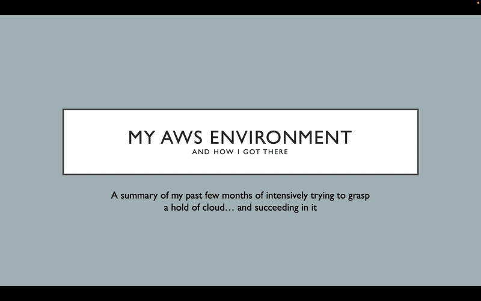
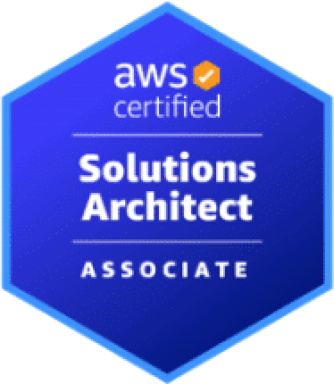
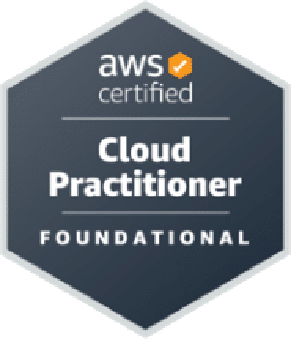

### Thesis Writer | Lihakilta.fi Webmaster | Cloud Architect | RPA Specialist

 

# Hello, everyone! &emsp;You've found your way to the right place 👍

I'm an automation-driven Business Information Technology candidate with a proven track record of deploying **AI agents, RPA workflows, and production-grade cloud architectures**

I engineer secure, end-to-end cloud infrastructure and data pipelines that transform complex business bottlenecks into highly automated digital workflows

* **Cloud Infrastructure:** Architecting scalable microservice environments utilizing modern AWS services
* **Process Automation:** Currently writing my Bachelor’s thesis on developing and deploying Robotic Process Automation systems

 

> ### 🎯 Open for New Opportunities
> **I'm currently seeking junior, trainee, or specialist roles in the IT and software sector**
> 
> With a solid foundation in data workflows, process automation, and cloud architecture, I'm ready to jump into technical teams, adapt to new stacks, and solve real business problems
> 
> *Feel free to reach out via email or LinkedIn below to discuss how I can add value to your team!*

 
 

<h2>
  💼 Professional Overview 
  <a href="./cv.pdf" style="text-decoration: none; margin-left: 15px; vertical-align: middle;">
    <kbd style="padding: 8px 15px; font-size: 0.6em; font-weight: bold; cursor: pointer; border-radius: 6px;">
      📄 View My CV (PDF)
    </kbd>
  </a>
</h2>
 
<ul>
  <li>
    <strong>Process Excellence Intern</strong> @ BSH Home Appliances in Sweden (June–October 2026)
    <ul>
      <li>Developed and deployed software robots on Virtual Machines for end-to-end data automation</li>
      <li>Streamlined Excel systems using VBA</li>
    </ul>
  </li>
   
  <li>
    <strong>Webmaster</strong> @ <a href="https://lihakilta.fi">lihakilta.fi</a> (since February 2026)
    <ul>
      <li>Develops and maintains Lihakilta's e-commerce platform using WordPress & WooCommerce</li>
    </ul>
  </li>
   
  <li>
    <strong>Award Winner</strong> @ Tampere University Game Fair 2021
    <ul>
      <li>Won the <em>Editor's Choice</em> award as Lead Programmer for the mobile game <a href="https://youtu.be/PSHA4EaZC10"><em>Mental Run</em></a></li>
    </ul>
  </li>
</ul>

 
 

## 🚀 Featured Projects

### 🤖 JobsAI – Agentic AI Implementation
> A production-grade multi-agent job search and automation tool for IT jobseekers that completely automates the pipeline from scraping job boards to generating tailored cover letters

<table>
  <tr>
    <td><strong>Backend &amp; AI:</strong></td>
    <td>
      
      
      
      
      
    </td>
  </tr>
  <tr>
    <td><strong>Frontend:</strong></td>
    <td>
      
      
      
      
    </td>
  </tr>
  <tr>
    <td><strong>Cloud Infrastructure &amp; CI/CD:</strong></td>
    <td>
      
      
    </td>
  </tr>
  <tr>
    <td><strong>Testing:</strong></td>
    <td>
      
      
    </td>
  </tr>
</table>

* **Serverless Agentic Architecture:** Engineered an asynchronous, event-driven pipeline deployed entirely on serverless infrastructure (**AWS Lambda & API Gateway**).
* **LLM-Powered Orchestration:** Developed 4 specialized, deterministic AI agents (**Profiler, QueryBuilder, Analyzer, and Generator**) running on OpenAI's GPT models to extract structured candidate skills, build optimized queries, and write tailored documents.
* **Data Engineering & State Management:** Implemented web scrapers (**BeautifulSoup**) targeting major job boards (Duunitori, Jobly) with state persistence and progress tracking managed via **Amazon DynamoDB & S3**.
* **Enterprise Delivery:** Automatically outputs personalized corporate-standard cover letters in Word format (`.docx`) delivered via presigned secure S3 URLs or automated email workflows (**AWS SES**).

*(Note: The live cloud deployment is currently offline to optimize AWS infrastructure costs, but the full implementation demo can be viewed below.)*

 

  

 

 

### ☁️ AWS Cloud Environment Architecture
> Production-grade cloud environments and automated full-stack architectures built entirely on AWS

   

<table>
  <tr>
    <td><strong>Languages &amp; Web:</strong></td>
    <td>
      
      
      
      
    </td>
  </tr>
  <tr>
    <td><strong>Core AWS Services:</strong></td>
    <td>
      
      
      
      
      
      
      
      
    </td>
  </tr>
  <tr>
    <td><strong>Management &amp; Analytics:</strong></td>
    <td>
      
      
      
      
    </td>
  </tr>
</table>

* **Robust Cloud Core:** Implemented secure architectures using **EC2, Lambda, S3, RDS, DynamoDB, VPC, CloudFront, and API Gateway**
* **Event-Driven Workflows:** Integrated advanced orchestration with **EventBridge, SNS, SQS, and CloudWatch**
* **Governance & Analysis:** Monitored system health with **CloudTrail, CloudFormation, and Amazon Athena**
* 📊 Download the full [*My AWS Environment* slideshow](https://github.com/jonidaniel/my-aws-environment/raw/refs/heads/main/my-aws-environment.pptx) for in-depth technical blueprints.

 

  

 

 

### 📈 Data Science & Machine Learning Projects
> A comprehensive collection of statistical data analysis, machine learning algorithms, and predictive modeling workflows

    

* Engineered end-to-end data pipelines for geospatial evaluation, predictive mapping, and regression analysis
* Deep practical experience with **Pandas, GeoPandas, NumPy, Leaflet, Shapefile.js, and GeoJSON**

 
 

## 🛠️ Technical Toolkit

| Category | Technologies |
| :--- | :--- |
| **Languages** | Python, R, VB/VBA |
| **Data & ML** | Pandas, Numpy, Matplotlib, Seaborn, Scikit-learn, GeoPandas, ggplot2 |
| **Databases** | MySQL |
| **Cloud & DevOps**| AWS (EC2, RDS, DynamoDB, API Gateway, Athena), Git |
| **Automation & BI**| UiPath (RPA), Power BI |

 
 

## 📜 Certifications

* **AWS Certified Solutions Architect – Associate (SAA-C03, valid until July 28, 2028)**
* **AWS Certified Cloud Practitioner – Foundational (CLF-C02, valid until June 12, 2028)**

&nbsp;&nbsp;&nbsp;&nbsp;&nbsp;&nbsp;&nbsp;&nbsp;&nbsp;&nbsp;&nbsp;&nbsp;&nbsp;&nbsp;&nbsp;&nbsp;&nbsp;&nbsp;&nbsp;&nbsp;&nbsp;

 
 

<h2>🎓 Education</h2>
 
<ul>
  <li>
    <strong>BBA in Business Information Technologies</strong> @ Laurea University of Applied Sciences
    <ul>
      <li><em>Specialization:</em> Software Production & Digital Service Development</li>
      <li><em>Graduation:</em> in coming months</li>
    </ul>
  </li>
   
  <li>
    <strong>Vocational Qualification in Business and Administration</strong></a> @ Rastor-instituutti
    <ul>
      <li><em>Specialization:</em> Customer Service and Sales</li>
      <li><em>Graduated:</em> 2018</li>
    </ul>
  </li>
   
  <li>
    <strong>Vocational Qualification in Electrical Engineering and Automation</strong> @ Sasky Vammalan ammattikoulu
    <ul>
      <li><em>Graduated:</em> 2012</li>
    </ul>
  </li>
</ul>

 
 

## 🗣️ Languages

* **Finnish:** Native
* **English:** Excellent spoken & written (professional working proficiency & presentations)
* **Swedish:** Basics (manages simple conversations & gets the job done)

 
 

## 📬 Connect with Me

<table border="0" cellpadding="5" cellspacing="0">
  <tr>
    <td><strong>📧 Email</strong></td>
    <td><a href="mailto:joni.potala@gmail.com">joni.potala@gmail.com</a></td>
  </tr>
  <tr>
    <td><strong>📞🇸🇪 Phone</strong></td>
    <td>+46737785460</td>
  </tr>
  <tr>
    <td><strong>📞🇫🇮 Phone</strong></td>
    <td>+358405882001</td>
  </tr>
  <tr>
    <td><strong>💼 LinkedIn</strong></td>
    <td><a href="https://www.linkedin.com/in/joni-potala/">in/joni-potala</a></td>
  </tr>
</table>
